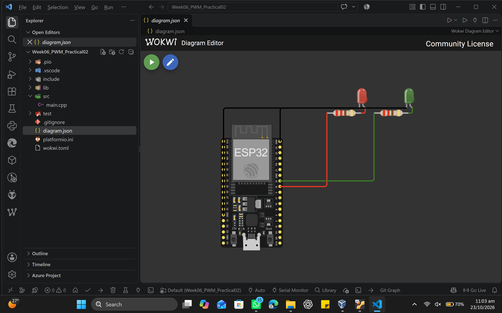
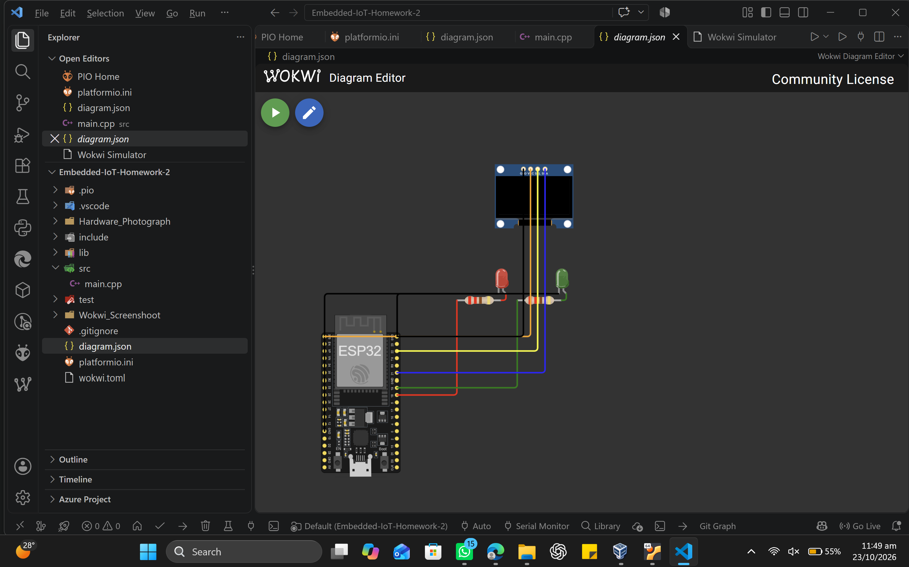
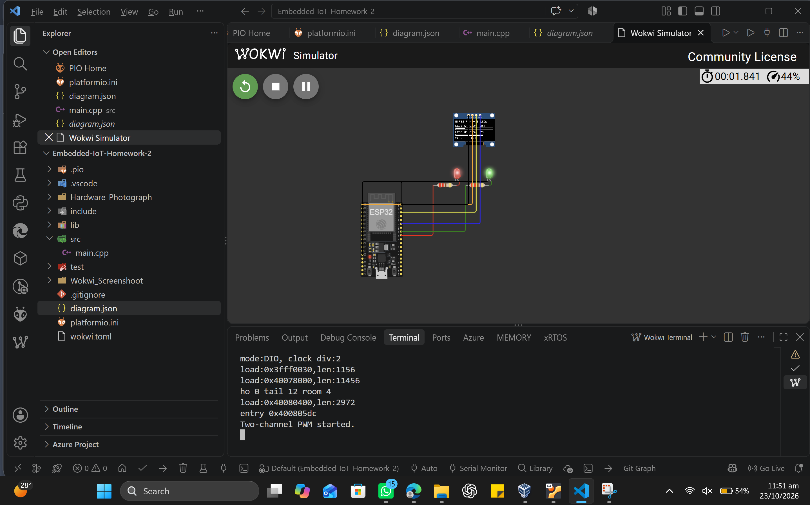
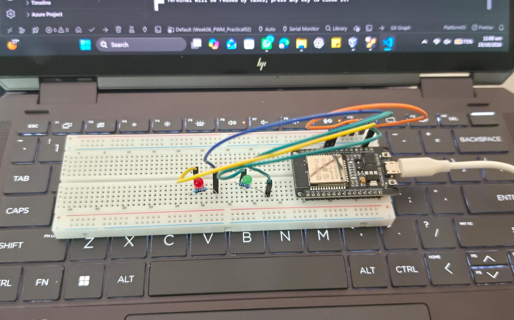
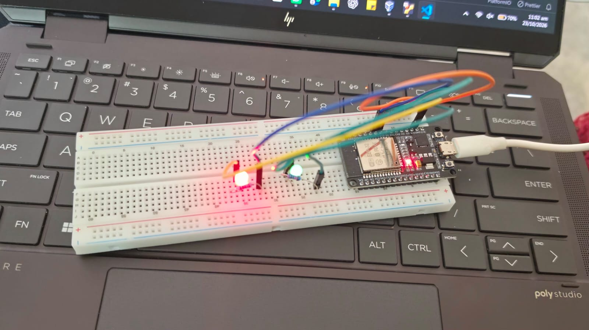
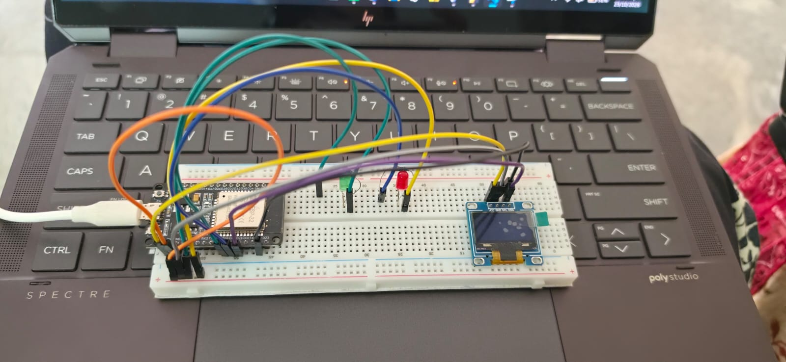

# Homework 2: Dual-LED PWM Control with OLED Monitoring

**Name:** Maham Naveed
**Course:** Embedded IoT Systems
**Registration No.:** 1044

## Project Description
This project uses an ESP32 to fade two LEDs with PWM. An SSD1306 I2C OLED shows the duty cycle (%) and PWM settings of both LEDs. The project was tested in Wokwi and on real hardware.

## Links
- Wokwi project: https://wokwi.com/projects/478839966002444289
- GitHub repository:https://github.com/MahamNaveed/24-NTU-CS-FL-1044-IOT

## Components
- ESP32 development board
- 2 LEDs (red and green)
- 2 resistors, one for each LED: [write resistor value]
- SSD1306 I2C OLED (128x64)
- Breadboard, jumper wires, USB cable

## Wiring

| Connection | ESP32 pin |
|---|---|
| LED 1 (red), through its own resistor | GPIO 18 |
| LED 2 (green), through its own resistor | GPIO 19 |
| LED cathodes | GND |
| OLED VCC | 3V3 |
| OLED GND | GND |
| OLED SDA | GPIO 21 |
| OLED SCL | GPIO 22 |

## PWM Settings
- PWM resolution: 8-bit (duty value 0 to 255)
- LED 1 frequency: [write frequency from main.cpp]
- LED 2 frequency: [write frequency from main.cpp]
- LEDC channels used: [write channels from main.cpp]

Duty cycle (%) = duty value / 255 x 100.

## How It Works
- Each LED is on its own LEDC PWM channel.
- The duty value of each LED goes up from minimum to maximum and then back down, so the LED fades smoothly.
- The duty values are kept in variables, and the same values are used for the LEDs and for the OLED.
- A higher duty cycle gives a brighter LED. Frequency changes how fast the signal switches, not the average brightness.
- Note: on the ESP32, LEDC channels that share a timer share the same frequency. For two different frequencies, the channels must use different timers.

## OLED Output
The OLED shows the title "ESP32 PWM - 2 LEDs", the duty cycle of LED1 and LED2 with bars, and the frequency and resolution line.
Example seen in my tests: LED1 GPIO18 = 25%, LED2 GPIO19 = 75%.

## Test Results
- Wokwi: both LEDs light and the OLED shows the PWM values. The terminal prints "Two-channel PWM started."
- Hardware: both LEDs light and the OLED shows the PWM values.
- Wokwi and hardware show the same text and values. Differences: breadboard wiring, the real OLED has yellow and blue colours, and Wokwi ran slower than real time (37% to 44%).

## Screenshots and Photos

### Wokwi (Task 1, without OLED)

### Wokwi (final, with OLED)

### Hardware (Task 1, without OLED)

### Hardware (final, with OLED)

## Project Files
- `src/main.cpp`: source code
- `diagram.json`: Wokwi circuit
- `platformio.ini`, `wokwi.toml`: project settings

## Commits
1. `task1 completed`
2. `complete homework`
